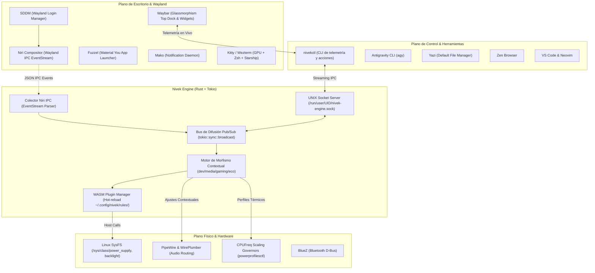

# Arquitectura Técnica: Nivek Reactive OS

Sistema operativo declarativo e inmutable basado en **NixOS con Arquitectura Dendrítica**, orquestado por un **motor de sistemas asíncrono en Rust puro (`tokio`)** con capacidades reactivas en tiempo real y extensibilidad mediante **WebAssembly (`wasmi 2.0`)**.



---

## 1. Núcleo Asíncrono en Rust (`nivek-core`)

El motor de sistemas se ejecuta como un servicio de usuario no privilegiado (`systemd.user.services.nivek-engine`) garantizando máxima seguridad en profundidad:
- **Latencia RTT**: Menor a **600 microsegundos** en invocaciones CLI.
- **Huella de Memoria**: Consumo RSS residente inferior a **10 MB**.
- **Canal de Difusión**: Basado en `tokio::sync::broadcast` con eventos clonables en memoria envueltos en `Arc<SystemEvent>`.

### Protocolo IPC Serializado (`nivek-wasm-abi`)
Toda la comunicación a través del socket UNIX (`$XDG_RUNTIME_DIR/nivek-engine.sock`) se realiza mediante mensajes JSON delimitados por saltos de línea con tipos formales:

```rust
pub enum IpcRequest {
    Ping,
    GetStatus,
    EmitEvent(SystemEvent),
    ExecuteAction(SystemAction),
    SubscribeEvents,
}
```

---

## 2. Morfismo Contextual Reactivo

El subsistema `morpher.rs` analiza los eventos de ventana emitidos por el compositor Niri y adapta el hardware automáticamente:

| Contexto | Desencadenante | Gobernador CPU | Perfil Audio | Brillo |
| :--- | :--- | :--- | :--- | :--- |
| **`dev`** | VS Code, Neovim, Kitty, Wezterm | `powersave` / `performance` | Plano / Monitor | 80% |
| **`media`** | Zen Browser, YouTube, MPV, Spotify | `balanced` | Enriquecido (Bass Boost) | Auto |
| **`gaming`** | Steam, Emuladores, Heroic | `performance` | Baja latencia | 100% |
| **`balanced`** | Uso general de escritorio | `balanced` | Estándar | 70% |

---

## 3. Extensibilidad WebAssembly (`wasmi 2.0`)

El motor incluye un supervisor de directorio en tiempo de ejecución sobre `~/.config/nivek/rules/`. Cualquier archivo `.wasm` o `.wat` colocado en este directorio es cargado e instanciado en caliente sin reiniciar el demonio.

Las funciones exportadas por el motor anfitrión permiten a los plugins controlar el hardware de forma segura:
* `env::set_brightness(delta: i32)`
* `env::log_msg(ptr: i32, len: i32)`
* `on_window_focus(title_ptr: i32, title_len: i32)`
* `on_battery(capacity: i32, is_charging: i32)`
